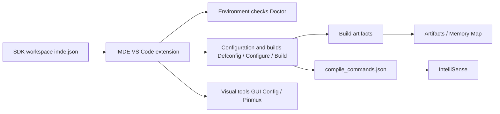

<div align="center">
  

  <h1>IMDE</h1>

  <p><strong>A VS Code development environment extension for Ingenic MCU SDK projects</strong></p>

  <p>
    <a href="README.md">简体中文</a> | English
  </p>

  <p>
    <a href="https://github.com/ingenic-official/MCU-IMDE/actions/workflows/ci.yml"></a>
    <a href="https://code.visualstudio.com/"></a>
    <a href="LICENSE"></a>
  </p>

  <p>
    <a href="https://github.com/ingenic-official/MCU-IMDE/releases/latest">Latest release</a>
    &nbsp;|&nbsp;
    <a href="#quick-start">Quick start</a>
    &nbsp;|&nbsp;
    <a href="docs/development.md">Development guide</a>
    &nbsp;|&nbsp;
    <a href="docs/architecture.md">Architecture</a>
  </p>
</div>

---

IMDE integrates the SDK's `tools/imde/imde.py` command-line interface into
VS Code. For Ingenic MCU SDK workspaces containing `imde.json`, it brings
environment checks, configuration, builds, Pinmux, Kconfig, artifact browsing,
and memory-map analysis into one workspace.

## Why IMDE

| Development area | What IMDE provides |
| --- | --- |
| Environment setup | `IMDE: Run Doctor` checks Python, CMake, Ninja, and toolchain status. |
| Build configuration | Select defconfigs, then configure, build, clean, or full-clean. |
| Visual configuration | Edit Kconfig through GUI Config while preserving dependency and visibility rules. |
| Board development | Discover chips and BSPs, configure Pinmux, and generate board source files. |
| Result analysis | Browse build artifacts and inspect ROM, RAM, modules, and source links in Memory Map. |
| Code completion | Update C/C++ IntelliSense from `compile_commands.json`. |

## Quick Start

### 1. Install the extension

1. Open the [latest release](https://github.com/ingenic-official/MCU-IMDE/releases/latest).
2. Download `imde-<version>.vsix`.
3. Run `Extensions: Install from VSIX...` from the VS Code Command Palette.
4. Select the VSIX and reload VS Code.

### 2. Open an SDK project

Open the SDK project folder containing `imde.json`, then run:

```text
IMDE: Run Doctor
```

When Doctor succeeds, start with:

```text
IMDE: Select Defconfig
IMDE: Configure
IMDE: Build
```

## Workflow



## Common Commands

| Command | Purpose |
| --- | --- |
| `IMDE: Run Doctor` | Check the SDK project and host development environment. |
| `IMDE: Select Defconfig` | Select and write the project defconfig. |
| `IMDE: Configure` | Create or update the build directory. |
| `IMDE: Build` | Build the current SDK project. |
| `IMDE: GUI Config` | Open the visual Kconfig configuration interface. |
| `IMDE: Pinmux` | Open the chip and BSP Pinmux configuration tool. |
| `IMDE: View Map` | Open an interactive Memory Map for a build artifact. |
| `IMDE: Setup IntelliSense` | Generate C/C++ IntelliSense settings from the compilation database. |

<details>
<summary><strong>Common settings</strong></summary>

| Setting | Default | Description |
| --- | --- | --- |
| `imde.projectDir` | Empty | Set the SDK project path when it is not the workspace root. |
| `imde.terminalName` | `IMDE` | Name shown for the integrated terminal. |
| `imde.captureTimeoutMs` | `15000` | Timeout in milliseconds for short JSON commands used by views. |
| `imde.commandTimeoutMs` | `0` | Timeout for non-interactive commands; `0` disables the limit. |
| `imde.showOutputOnError` | `true` | Reveal the IMDE terminal when a managed command fails. |
| `imde.guiConfig.autoHeaderPath` | Empty | Optional path for a C header generated by GUI Config. |

</details>

## Development

```powershell
npm ci
npm run verify
```

`verify` runs strict type checks, webpack builds, automated tests, and VSIX
content validation in sequence.

| Document | Contents |
| --- | --- |
| [Development guide](docs/development.md) | Debugging, builds, tests, packaging, and releases. |
| [Architecture](docs/architecture.md) | Extension host, webview, and feature-module boundaries. |
| [Release checklist](docs/releasing.md) | Version and GitHub Release steps. |
| [Changelog](CHANGELOG.md) | Version history and user-visible changes. |

## Repository Layout

```text
.
|- src/                 Extension TypeScript and webview source
|- test/                Automated tests and reusable fixtures
|- media/               Runtime icon assets for the extension
|- docs/                Development, architecture, and release documentation
|- .github/             CI and contributor-facing GitHub configuration
|- CHANGELOG.md         Version history
|- package.json         Extension manifest and npm scripts
`- webpack.config.js    Extension and webview bundling configuration
```

## Contributing and Security

Bug reports and feature requests are welcome through GitHub Issues. Read
[CONTRIBUTING.md](CONTRIBUTING.md) before opening a pull request. Do not report
security issues publicly; follow the private reporting process in
[SECURITY.md](SECURITY.md).

## License

This project is distributed under the [ISC License](LICENSE).

<p align="right"><a href="#imde">Back to top</a></p>
