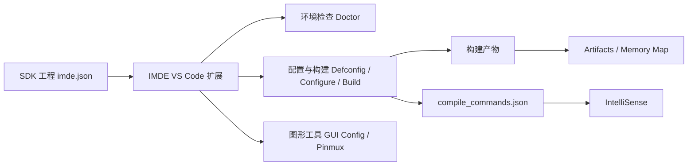

<div align="center">
  

  <h1>IMDE</h1>

  <p><strong>Ingenic MCU SDK 的 VS Code 开发环境扩展</strong></p>

  <p>
    简体中文 | <a href="README.en.md">English</a>
  </p>

  <p>
    <a href="https://github.com/ingenic-official/MCU-IMDE/actions/workflows/ci.yml"></a>
    <a href="https://code.visualstudio.com/"></a>
    <a href="LICENSE"></a>
  </p>

  <p>
    <a href="https://github.com/ingenic-official/MCU-IMDE/releases/latest">最新发布</a>
    &nbsp;|&nbsp;
    <a href="#快速开始">快速开始</a>
    &nbsp;|&nbsp;
    <a href="docs/development.md">开发文档</a>
    &nbsp;|&nbsp;
    <a href="docs/architecture.md">架构说明</a>
  </p>
</div>

---

IMDE 将 SDK 中的 `tools/imde/imde.py` 命令行工具集成到 VS Code。它面向
包含 `imde.json` 的 Ingenic MCU SDK 工程，把环境检查、配置、构建、Pinmux、
Kconfig、产物浏览和 Memory Map 分析统一到一个工作区。

## 为什么使用 IMDE

| 开发环节 | IMDE 提供的能力 |
| --- | --- |
| 环境准备 | `IMDE: Run Doctor` 检查 Python、CMake、Ninja 与工具链状态。 |
| 构建配置 | 选择 defconfig，执行 Configure、Build、Clean 与 Full Clean。 |
| 图形配置 | 通过 GUI Config 编辑 Kconfig，并保留 Kconfig 依赖与可见性规则。 |
| 板级开发 | 发现芯片和 BSP，配置 Pinmux 并生成板级源文件。 |
| 结果分析 | 浏览构建产物，在 Memory Map 中查看 ROM、RAM、模块和源文件关联。 |
| 代码补全 | 从 `compile_commands.json` 更新 C/C++ IntelliSense 配置。 |

## 快速开始

### 1. 安装扩展

1. 打开 [最新 Release](https://github.com/ingenic-official/MCU-IMDE/releases/latest)。
2. 下载 `imde-<version>.vsix`。
3. 在 VS Code 命令面板执行 `Extensions: Install from VSIX...`。
4. 选择下载的 VSIX，然后重新加载 VS Code。

### 2. 打开 SDK 工程

在 VS Code 中打开包含 `imde.json` 的 SDK 工程目录，然后运行：

```text
IMDE: Run Doctor
```

Doctor 通过后，按以下顺序开始工作：

```text
IMDE: Select Defconfig
IMDE: Configure
IMDE: Build
```

## 工作流



## 常用命令

| 命令 | 用途 |
| --- | --- |
| `IMDE: Run Doctor` | 检查 SDK 工程与主机开发环境。 |
| `IMDE: Select Defconfig` | 选择并写入工程 defconfig。 |
| `IMDE: Configure` | 生成或更新构建目录。 |
| `IMDE: Build` | 构建当前 SDK 工程。 |
| `IMDE: GUI Config` | 打开 Kconfig 图形化配置界面。 |
| `IMDE: Pinmux` | 打开芯片与 BSP 的 Pinmux 配置工具。 |
| `IMDE: View Map` | 打开构建产物的交互式 Memory Map。 |
| `IMDE: Setup IntelliSense` | 根据编译数据库生成 C/C++ IntelliSense 配置。 |

<details>
<summary><strong>常用设置</strong></summary>

| 设置 | 默认值 | 说明 |
| --- | --- | --- |
| `imde.projectDir` | 空 | SDK 工程不是工作区根目录时，指定工程路径。 |
| `imde.terminalName` | `IMDE` | 集成终端显示的名称。 |
| `imde.captureTimeoutMs` | `15000` | 视图使用的短时 JSON 命令超时，单位为毫秒。 |
| `imde.commandTimeoutMs` | `0` | 非交互命令超时；`0` 表示不限制。 |
| `imde.showOutputOnError` | `true` | 受管命令失败时显示 IMDE 终端。 |
| `imde.guiConfig.autoHeaderPath` | 空 | GUI Config 生成 C 头文件的可选路径。 |

</details>

## 开发

```powershell
npm ci
npm run verify
```

`verify` 会依次执行严格类型检查、Webpack 构建、自动化测试和 VSIX 内容检查。

| 文档 | 内容 |
| --- | --- |
| [开发文档](docs/development.md) | 调试、构建、测试、打包与发布流程。 |
| [架构说明](docs/architecture.md) | 扩展 Host、Webview 和功能模块边界。 |
| [Release 清单](docs/releasing.md) | 版本发布与 GitHub Release 步骤。 |
| [更新日志](CHANGELOG.md) | 版本历史与用户可见变更。 |

## 仓库结构

```text
.
|- src/                 扩展 TypeScript 与 Webview 源码
|- test/                自动化测试与可复用 fixture
|- media/               扩展运行所需的图标资源
|- docs/                开发、架构与发布文档
|- .github/             CI 与 GitHub 协作配置
|- CHANGELOG.md         版本历史
|- package.json         扩展清单与 npm 脚本
`- webpack.config.js    扩展与 Webview 打包配置
```

## 贡献与安全

欢迎通过 GitHub Issues 报告问题或提出功能建议。提交 Pull Request 前请阅读
[CONTRIBUTING.md](CONTRIBUTING.md)。安全问题请不要公开提交，应遵循
[SECURITY.md](SECURITY.md) 中的私密报告流程。

## 许可证

本项目使用 [ISC License](LICENSE) 发布。

<p align="right"><a href="#imde">回到顶部</a></p>
